# 领导决策汇报｜PPT引擎试点建议

## 可用结论

建议有条件批准；范围、责任、资料授权和资源/退出条件未明确前不启动。

15分钟建议讲述；12页。事实/分析/建议逐页标注；预算、人员、日期、数量与试点政策均待确认。

## 生成边界

这是助手基于本项目源码及历史测试证据编排的案例，通过项目真实材料解析、编译器和LibreOffice导出。未调用后台外部模型，不能据此声称生产AI规划质量已验收。PPTX含原生文字、表格、图表和讲稿；没有位图铺满替代可编辑页。内置浏览器仅查看，不提供P2局部编辑；请下载PPTX编辑。

所有文件为待人工复核的草稿（needs-human-review；commercialApproval:false）。PPTX未嵌入字体，接收方需安装Noto Sans SC常规/粗体。目标PowerPoint/WPS/Keynote编辑、商业视觉、来源语义、图表内部标签仍需人工验收。历史240/25/19/4不冒称本次新测或全仓通过。

## 01｜建议有条件批准小范围试点

性质：建议；建议讲述 45 秒。

正文（可编辑对象的真实内容）：

- 【建议】领导决策汇报 · 15分钟建议讲述 · 待拍板，非已批准

图示：结论型封面；保留“建议”和“待决策”标签，不使用虚构业绩图。

来源：E01 用户确认的决策需求；E02 实际编译与导出链路；E03 质量状态及未完成验收

讲稿：各位领导，本次汇报只讨论一个决定：当前PPT引擎是否可以进入有边界的小范围试点。我的建议是有条件批准，而不是宣布商业就绪或全面推广。源码已经具备材料规划、原生PPTX编译、PDF及预览导出和质量报告链路；但真实商业材料、真实模型表现和目标Office编辑效果仍未完成验收。后面会把已证实的事实、选项分析及待确认事项分开呈现。今天不请求未经测算的预算，也不承诺没有证据的上线日期。

来源位置：source-1-p-1；source-1-p-2；source-1-p-3
助手基于源码证据编排；未调用后台外部模型，仍需人工事实与Office验收。

仓库依据（快照）：
E01 docs/examples/leader-decision/brief.md:L1–L8
E02 server/skills/presentation/pipeline.ts:L63–L73；shared/presentation.ts:L1–L8
E03 server/skills/presentation/quality.ts:L41–L64；docs/commercial-ppt-engine.md:L135–L144

## 02｜本次请求：批准试点边界，不背书全面推广

性质：建议；建议讲述 90 秒。

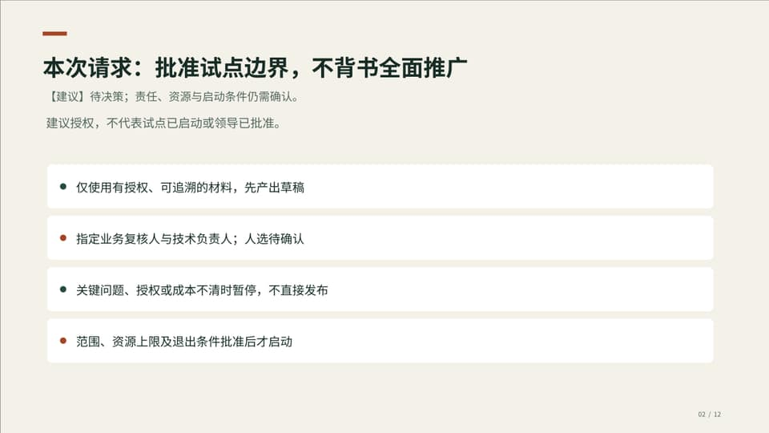

正文（可编辑对象的真实内容）：

- 【建议】待决策；责任、资源与启动条件仍需确认。
- 建议授权，不代表试点已启动或领导已批准。
- 仅使用有授权、可追溯的材料，先产出草稿
- 指定业务复核人与技术负责人；人选待确认
- 关键问题、授权或成本不清时暂停，不直接发布
- 范围、资源上限及退出条件批准后才启动

图示：四项决策卡；分别显示授权范围、复核责任、停止条件和资源约束。

来源：E01 用户确认的决策需求；E03 质量状态及未完成验收；E08 汇报场景入口与执行授权

讲稿：需要领导确认的是试点授权的边界，而不是替每一份PPT作事实担保。建议仅选有明确使用目的、可访问且有授权的材料；先产生可复核草稿，再由指定人员核对事实、口径和编辑效果。任何关键质量问题、授权不清或成本无法控制，都应暂停试跑。业务复核人、技术负责人、资源上限和停止条件目前没有提供，必须在启动前确认。源码中的执行成功状态不能自动转化为商业发布批准。本页全部是建议条件，不是已经生效的管理制度。

来源位置：source-1-p-1；source-1-p-3；source-1-p-8
助手基于源码证据编排；未调用后台外部模型，仍需人工事实与Office验收。

仓库依据（快照）：
E01 docs/examples/leader-decision/brief.md:L1–L8
E03 server/skills/presentation/quality.ts:L41–L64；docs/commercial-ppt-engine.md:L135–L144
E08 frontend/workspace/skillPainpointMap.ts:L21–L53；server/skills/presentation/pipeline.ts:L34–L49；apps/web/src/inspiration/samples/LeaderDecisionReport.tsx:L54–L63

## 03｜已有工程证据，但不是商业质量认证

性质：事实；建议讲述 75 秒。

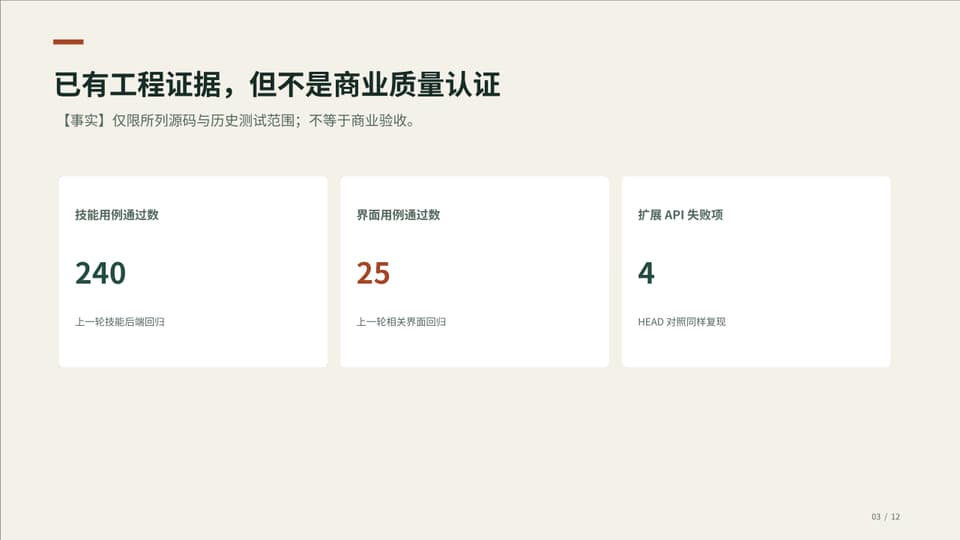

正文（可编辑对象的真实内容）：

- 【事实】仅限所列源码与历史测试范围；不等于商业验收。
- 技能用例通过数
- 240
- 上一轮技能后端回归
- 界面用例通过数
- 25
- 上一轮相关界面回归
- 扩展API失败项
- 4
- HEAD对照同样复现

图示：原生指标卡；三个指标分别标注口径，不拼成综合成功率。

来源：D01 历史测试计数；E03 质量状态及未完成验收；E04 上一轮回归与隔离基线记录

讲稿：这里引用的是上一轮已保存的测试记录，不是今天重新跑出来的覆盖率。技能后端回归有240项通过，相关界面回归有25项通过；另外扩展API检查仍有4项失败。这三项采用不同测试范围，不能相加计算一个所谓全仓通过率，也不能用界面通过数推导客户满意度或商业视觉水平。后端测试覆盖原生对象、来源绑定、导出、恢复和隔离等工程链路；仍需用真实业务材料和目标Office完成验收。测试记录中的0跳过也只属于该批测试，不代表所有可能环境均已覆盖。

来源位置：source-2-table-1；source-1-p-3；source-1-p-4
助手基于源码证据编排；未调用后台外部模型，仍需人工事实与Office验收。

仓库依据（快照）：
D01 见随附来源与字段口径
E03 server/skills/presentation/quality.ts:L41–L64；docs/commercial-ppt-engine.md:L135–L144
E04 docs/commercial-ppt-engine.md:L94–L110；.cache/presentation-full-skills-serial.log:L1535–L1543；.cache/presentation-ui-final.log:L32–L32；.cache/presentation-api-regression.log:L222–L230；.cache/presentation-api-head-baseline.log:L223–L231

## 04｜可以交付可编辑草稿，不能承诺商业成稿

性质：事实；建议讲述 75 秒。

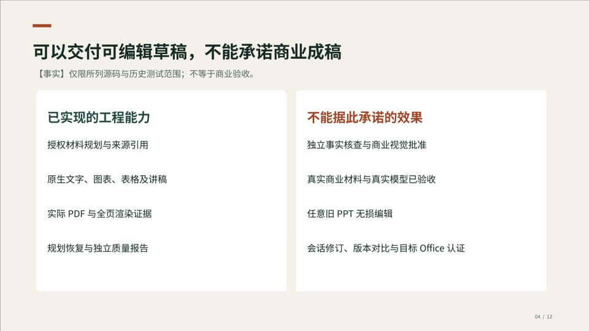

正文（可编辑对象的真实内容）：

- 【事实】仅限所列源码与历史测试范围；不等于商业验收。
- 已实现的工程能力
- 授权材料规划与来源引用
- 原生文字、图表、表格及讲稿
- 实际PDF与全页渲染证据
- 规划恢复与独立质量报告
- 不能据此承诺的效果
- 独立事实核查与商业视觉批准
- 真实商业材料与真实模型已验收
- 任意旧PPT无损编辑
- 会话修订、版本对比与目标Office认证

图示：两栏能力边界对照；“已实现”和“未验收/未实现”同屏。

来源：E02 实际编译与导出链路；E03 质量状态及未完成验收；E06 字体和人工验收边界

讲稿：源码可以接收明确需求和多份材料，在单次授权后进行逐页规划，再由代码生成可编辑文字、形状、图表、表格和讲稿；本机LibreOffice提供PDF和逐页预览，质量报告保留来源和告警。边界同样重要：当前没有独立语义事实核查，没有自动商业视觉批准，也没有任意旧PPT无损编辑或会话局部修订。PPTX不内嵌字体，接收方需要相应字体并复核重排。判断是否试点，应建立在这些真实能力与限制上，而不是把规范导出误称为咨询公司定制成稿。

来源位置：source-1-p-2；source-1-p-3；source-1-p-6
助手基于源码证据编排；未调用后台外部模型，仍需人工事实与Office验收。

仓库依据（快照）：
E02 server/skills/presentation/pipeline.ts:L63–L73；shared/presentation.ts:L1–L8
E03 server/skills/presentation/quality.ts:L41–L64；docs/commercial-ppt-engine.md:L135–L144
E06 docs/commercial-ppt-engine.md:L81–L93

## 05｜扩展API仍有失败，需先判断试点影响

性质：事实；建议讲述 75 秒。

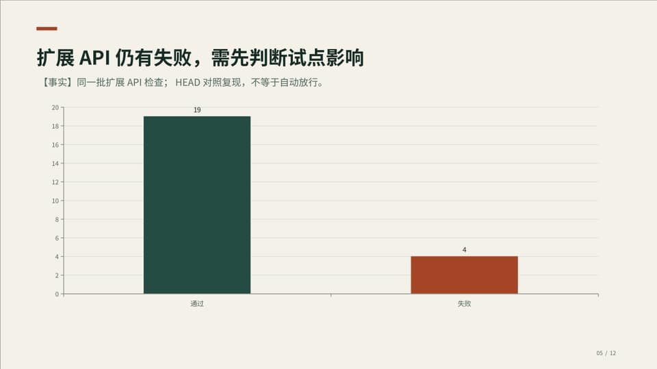

正文（可编辑对象的真实内容）：

- 【事实】同一批扩展API检查；HEAD对照复现，不等于自动放行。
- 通过：用例数 19
- 失败：用例数 4

图示：原生柱状图，只比较同一API检查批次中的通过/失败数量；不得标为全仓成功率。

来源：D02 扩展API同批计数；E04 上一轮回归与隔离基线记录

讲稿：这张图只展示同一批23项扩展API检查的结果：19项通过、4项失败。隔离的HEAD源码树复现了相同失败，因此没有证据把它们归因于本次PPT变更；但既存不等于可以忽略。失败涉及未配置通道时的错误、模型目录配置状态、未配置额度接口和匿名HTTP接口鉴权期望。下一步需要逐项确认它们是否影响拟选的试点路径，以及应当修复、限制范围还是设置启动阻断。这里不推断生产事故已经发生，也不把“基线同样失败”当成自动放行理由。

来源位置：source-3-table-1；source-1-p-4
助手基于源码证据编排；未调用后台外部模型，仍需人工事实与Office验收。

仓库依据（快照）：
D02 见随附来源与字段口径
E04 docs/commercial-ppt-engine.md:L94–L110；.cache/presentation-full-skills-serial.log:L1535–L1543；.cache/presentation-ui-final.log:L32–L32；.cache/presentation-api-regression.log:L222–L230；.cache/presentation-api-head-baseline.log:L223–L231

## 06｜三种可选路径：建议选择受控试点

性质：分析；建议讲述 105 秒。

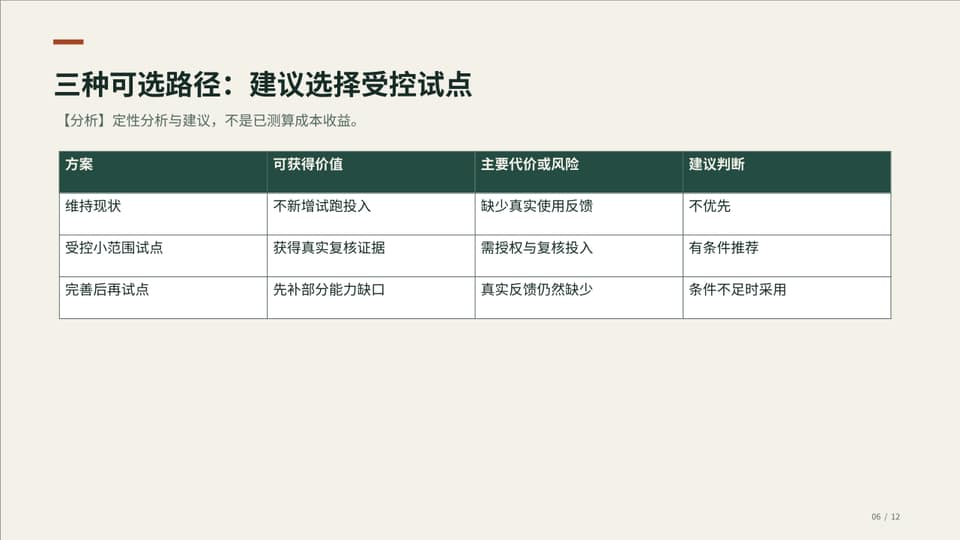

正文（可编辑对象的真实内容）：

- 【分析】定性分析与建议，不是已测算成本收益。
- 方案｜可获得价值｜主要代价或风险｜建议判断
- 维持现状｜不新增试跑投入｜缺少真实使用反馈｜不优先
- 受控小范围试点｜获得真实复核证据｜需授权与复核投入｜有条件推荐
- 完善后再试点｜先补部分能力缺口｜真实反馈仍然缺少｜条件不足时采用

图示：原生三方案比较表；不编造评分、ROI、预算或概率。

来源：D03 三方案比较；E03 质量状态及未完成验收；E04 上一轮回归与隔离基线记录

讲稿：当前有三种实际可讨论的路径。维持现状，不新增试点投入，但无法获得真实材料的使用反馈；在明确边界下小范围试点，能够把模型表现、复核投入和目标Office兼容性转化为可记录证据，但必须承担受控的试跑与复核工作；继续完善后再试点，可以先处理部分缺口，但在真实反馈不足时可能扩大开发范围。表内是基于当前能力和缺口作出的定性分析，不是已经测得的成本收益或项目排期。建议选择受控试点，并以前述授权、责任和退出条件为前提。

来源位置：source-4-table-1；source-1-p-3；source-1-p-4
助手基于源码证据编排；未调用后台外部模型，仍需人工事实与Office验收。

仓库依据（快照）：
D03 见随附来源与字段口径
E03 server/skills/presentation/quality.ts:L41–L64；docs/commercial-ppt-engine.md:L135–L144
E04 docs/commercial-ppt-engine.md:L94–L110；.cache/presentation-full-skills-serial.log:L1535–L1543；.cache/presentation-ui-final.log:L32–L32；.cache/presentation-api-regression.log:L222–L230；.cache/presentation-api-head-baseline.log:L223–L231

## 07｜试点的价值：把未知变成可核对证据

性质：建议；建议讲述 90 秒。

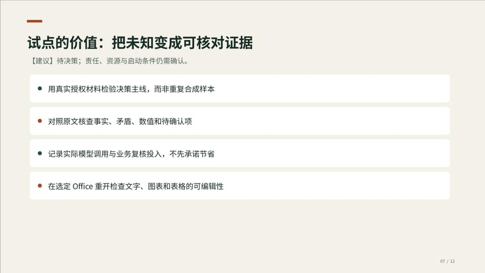

正文（可编辑对象的真实内容）：

- 【建议】待决策；责任、资源与启动条件仍需确认。
- 用真实授权材料检验决策主线，而非重复合成样本
- 对照原文核查事实、矛盾、数值和待确认项
- 记录实际模型调用与业务复核投入，不先承诺节省
- 在选定Office重开检查文字、图表和表格的可编辑性

图示：四项验证任务卡；每项对应明确的证据，而非泛化“提升效率”。

来源：E01 用户确认的决策需求；E03 质量状态及未完成验收；E06 字体和人工验收边界；E08 汇报场景入口与执行授权

讲稿：推荐试点，不是因为全部问题已经解决，而是已有链路足以承载受控验证。试点应该回答四个尚未有答案的问题：真实材料能否形成领导可用的决策主线；模型会不会误解事实、遗漏矛盾或给出无依据结论；业务人员需要投入多少复核时间；接收方在目标Office打开后，图表、表格和字体是否保持可编辑、可读。建议把这些问题作为每次试跑的记录项。若只是重复导出既有合成样本，或只看截图漂亮而不核对原文，就不能证明试点取得了有效结果。

来源位置：source-1-p-1；source-1-p-3；source-1-p-6；source-1-p-8
助手基于源码证据编排；未调用后台外部模型，仍需人工事实与Office验收。

仓库依据（快照）：
E01 docs/examples/leader-decision/brief.md:L1–L8
E03 server/skills/presentation/quality.ts:L41–L64；docs/commercial-ppt-engine.md:L135–L144
E06 docs/commercial-ppt-engine.md:L81–L93
E08 frontend/workspace/skillPainpointMap.ts:L21–L53；server/skills/presentation/pipeline.ts:L34–L49；apps/web/src/inspiration/samples/LeaderDecisionReport.tsx:L54–L63

## 08｜成本尚未测算：先明确记录口径和上限

性质：分析；建议讲述 90 秒。

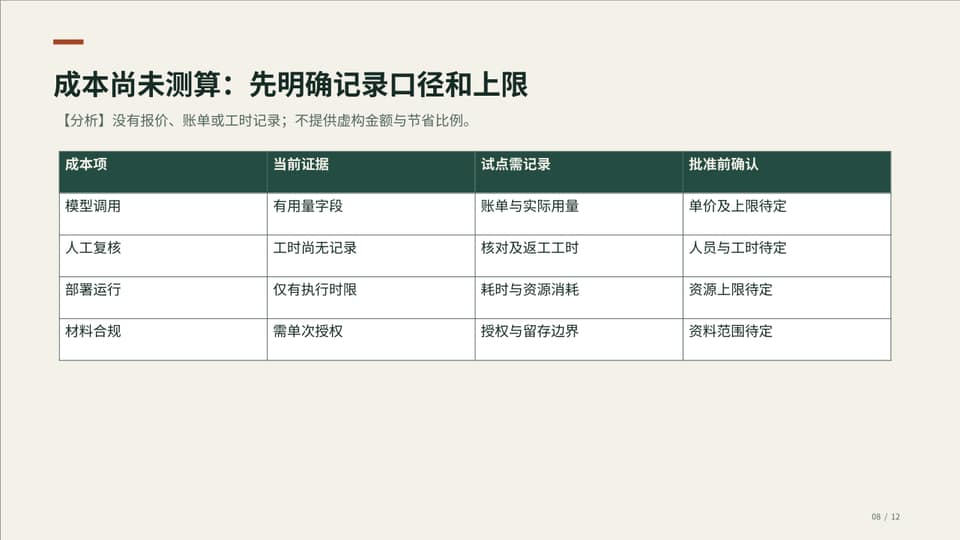

正文（可编辑对象的真实内容）：

- 【分析】没有报价、账单或工时记录；不提供虚构金额与节省比例。
- 成本项｜当前证据｜试点需记录｜批准前确认
- 模型调用｜有用量字段｜账单与实际用量｜单价及上限待定
- 人工复核｜工时尚无记录｜核对及返工工时｜人员与工时待定
- 部署运行｜仅有执行时限｜耗时与资源消耗｜资源上限待定
- 材料合规｜需单次授权｜授权与留存边界｜资料范围待定

图示：原生成本口径表；金额、单价与工时全部待确认，不画虚构成本饼图。

来源：D04 成本口径；E05 授权、恢复与用量边界；E07 执行预算不是实测耗时/成本；E08 汇报场景入口与执行授权

讲稿：目前没有服务商账单、人工工时或部署报价，因此不能给出可信的预算和节省比例。表中列出必须记录的成本项及对应口径。模型成本以服务商实际用量和计价为准，不能用未报告的token估算；人工成本需要记录逐页复核和返工时间；部署运行资源要区分配置的最大执行时限与实际耗时，不能把时限当成平均性能；材料合规则需要确认提供商留存政策和允许的资料范围。建议由领导指定资源上限的审批责任，再由试点结果形成测算。金额、单价、工时和总额目前均待确认。

来源位置：source-4-table-2；source-1-p-5；source-1-p-7；source-1-p-8
助手基于源码证据编排；未调用后台外部模型，仍需人工事实与Office验收。

仓库依据（快照）：
D04 见随附来源与字段口径
E05 server/skills/presentation/pipeline.ts:L34–L62；server/skills/presentation/usage.ts:L1–L10；docs/commercial-ppt-engine.md:L77–L80
E07 docs/commercial-ppt-engine.md:L75–L76
E08 frontend/workspace/skillPainpointMap.ts:L21–L53；server/skills/presentation/pipeline.ts:L34–L49；apps/web/src/inspiration/samples/LeaderDecisionReport.tsx:L54–L63

## 09｜风险要有触发条件和应对动作

性质：分析；建议讲述 90 秒。

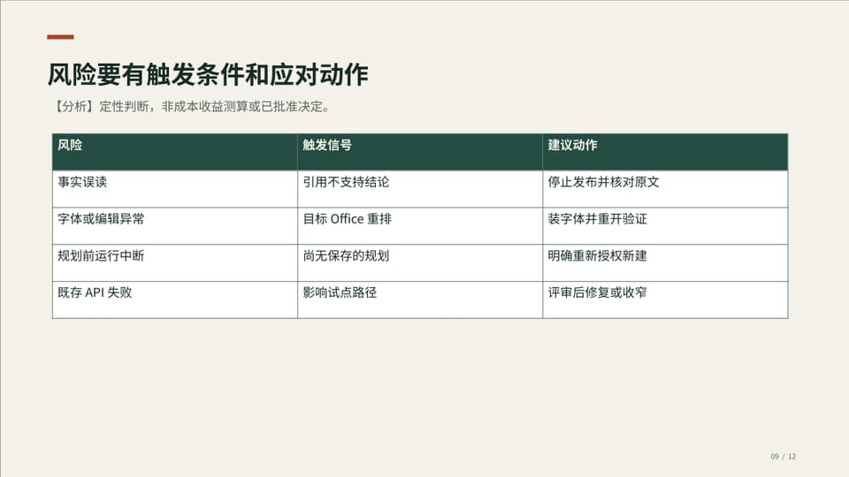

正文（可编辑对象的真实内容）：

- 【分析】定性判断，非成本收益测算或已批准决定。
- 风险｜触发信号｜建议动作
- 事实误读｜引用不支持结论｜停止发布并核对原文
- 字体或编辑异常｜目标Office重排｜装字体并重开验证
- 规划前运行中断｜尚无保存的规划｜明确重新授权新建
- 既存API失败｜影响试点路径｜评审后修复或收窄

图示：原生风险/触发/处置表；不编造概率、损失金额或严重性评分。

来源：D05 风险处置；E03 质量状态及未完成验收；E04 上一轮回归与隔离基线记录；E05 授权、恢复与用量边界；E06 字体和人工验收边界

讲稿：风险管理应当说明何时触发、如何处置，而不是随意给出高低概率。事实误读的触发信号是引用存在但结论不被原文支持；应停止发布并由业务人员逐项核对。字体或编辑异常需要在选定Office中复现，先确认字体与原生对象，不用缩字掩盖问题。中断发生在规划保存前，不能假定可以继续；需要重新授权新建，避免未知外部请求静默重放。对既存API失败则先评估影响，再决定修复或收窄试点范围。以上是建议的处置方案，不代表风险已经发生或全部关闭。

来源位置：source-4-table-3；source-1-p-3；source-1-p-4；source-1-p-5；source-1-p-6
助手基于源码证据编排；未调用后台外部模型，仍需人工事实与Office验收。

仓库依据（快照）：
D05 见随附来源与字段口径
E03 server/skills/presentation/quality.ts:L41–L64；docs/commercial-ppt-engine.md:L135–L144
E04 docs/commercial-ppt-engine.md:L94–L110；.cache/presentation-full-skills-serial.log:L1535–L1543；.cache/presentation-ui-final.log:L32–L32；.cache/presentation-api-regression.log:L222–L230；.cache/presentation-api-head-baseline.log:L223–L231
E05 server/skills/presentation/pipeline.ts:L34–L62；server/skills/presentation/usage.ts:L1–L10；docs/commercial-ppt-engine.md:L77–L80
E06 docs/commercial-ppt-engine.md:L81–L93

## 10｜按关卡推进，不承诺未经评估的日期

性质：建议；建议讲述 75 秒。

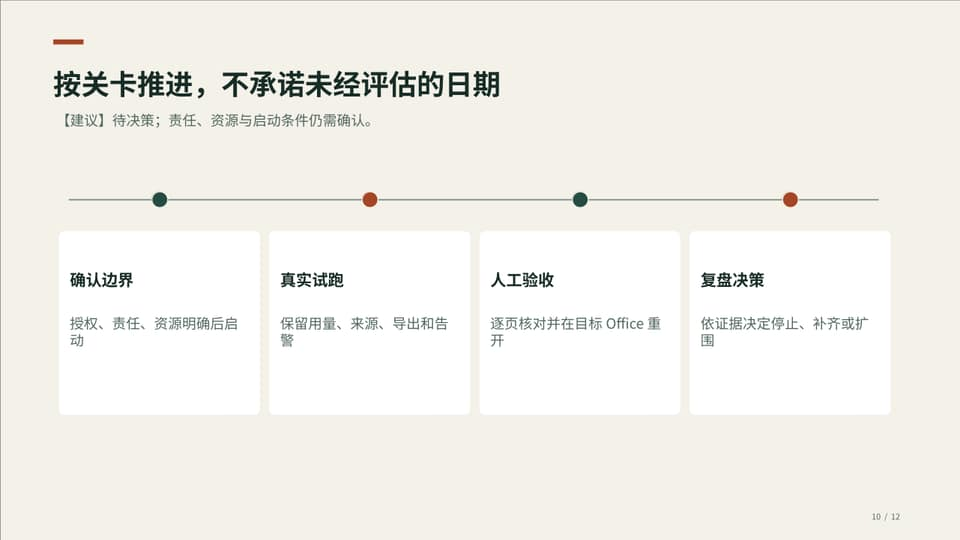

正文（可编辑对象的真实内容）：

- 【建议】待决策；责任、资源与启动条件仍需确认。
- 确认边界
- 授权、责任、资源明确后启动
- 真实试跑
- 保留用量、来源、导出和告警
- 人工验收
- 逐页核对并在目标Office重开
- 复盘决策
- 依证据决定停止、补齐或扩围

图示：四阶段关卡时间线，无虚构日期、工期或人名。

来源：E01 用户确认的决策需求；E03 质量状态及未完成验收；E05 授权、恢复与用量边界；E08 汇报场景入口与执行授权

讲稿：建议按关卡推进，而不是现在给出没有排期依据的日历承诺。首先确认材料授权、使用对象、责任人与资源边界；其次用已确认的材料和模型通道真实试跑，并保留用量、来源、导出和告警；随后由业务人员逐页复核，并在选定Office重开检查；最后根据问题和实际投入决定停止、补齐后继续，还是扩大范围。任何前置关卡未满足都不应跳过。这里的四步是建议的执行顺序，具体负责人、开始日期、持续时间和样本数量均需确认后另行排期。

来源位置：source-1-p-1；source-1-p-3；source-1-p-5；source-1-p-8
助手基于源码证据编排；未调用后台外部模型，仍需人工事实与Office验收。

仓库依据（快照）：
E01 docs/examples/leader-decision/brief.md:L1–L8
E03 server/skills/presentation/quality.ts:L41–L64；docs/commercial-ppt-engine.md:L135–L144
E05 server/skills/presentation/pipeline.ts:L34–L62；server/skills/presentation/usage.ts:L1–L10；docs/commercial-ppt-engine.md:L77–L80
E08 frontend/workspace/skillPainpointMap.ts:L21–L53；server/skills/presentation/pipeline.ts:L34–L49；apps/web/src/inspiration/samples/LeaderDecisionReport.tsx:L54–L63

## 11｜达标才扩围：导出成功不是唯一门槛

性质：建议；建议讲述 60 秒。

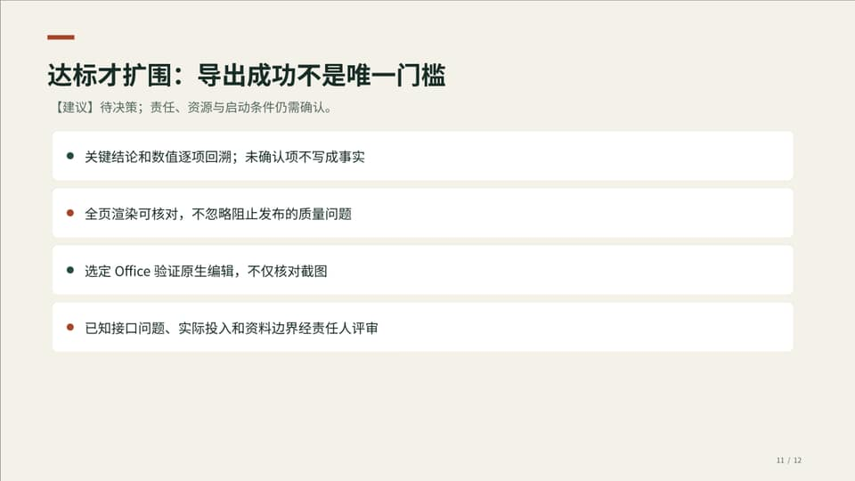

正文（可编辑对象的真实内容）：

- 【建议】待决策；责任、资源与启动条件仍需确认。
- 关键结论和数值逐项回溯；未确认项不写成事实
- 全页渲染可核对，不忽略阻止发布的质量问题
- 选定Office验证原生编辑，不仅核对截图
- 已知接口问题、实际投入和资料边界经责任人评审

图示：四条验收门槛；注明是建议的试点标准，非已完成验收。

来源：E01 用户确认的决策需求；E03 质量状态及未完成验收；E06 字体和人工验收边界

讲稿：建议把是否扩围与可验证门槛挂钩。首先，每一项关键结论和数值都能够回到材料位置，未确认项不得写成既定事实；其次，PDF和所有页图可核对，缺字、越界、重叠或其他阻止发布的问题没有被忽略；再次，接收方在选定Office中验证原生文字、图表和表格，而不是只打开了位图截图；最后，已知API问题和实际投入经过责任人评审，材料授权与留存边界持续有效。当前质量报告没有商业批准入口，技术状态不能替代人工签核。扩围仍需新的决策，不因本次试点授权自动发生。

来源位置：source-1-p-1；source-1-p-3；source-1-p-6
助手基于源码证据编排；未调用后台外部模型，仍需人工事实与Office验收。

仓库依据（快照）：
E01 docs/examples/leader-decision/brief.md:L1–L8
E03 server/skills/presentation/quality.ts:L41–L64；docs/commercial-ppt-engine.md:L135–L144
E06 docs/commercial-ppt-engine.md:L81–L93

## 12｜请确认范围、责任、资源与退出条件

性质：建议；建议讲述 30 秒。

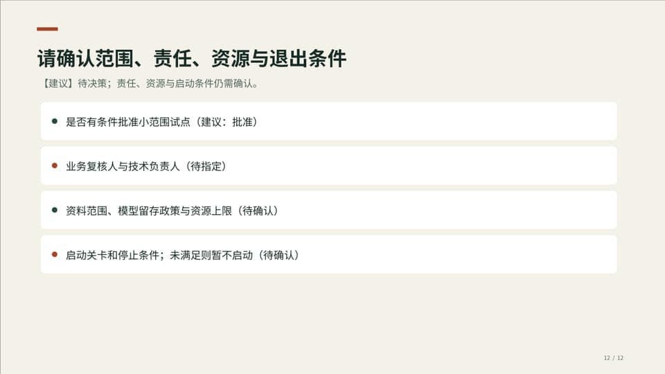

正文（可编辑对象的真实内容）：

- 【建议】待决策；责任、资源与启动条件仍需确认。
- 是否有条件批准小范围试点（建议：批准）
- 业务复核人与技术负责人（待指定）
- 资料范围、模型留存政策与资源上限（待确认）
- 启动关卡和停止条件；未满足则暂不启动（待确认）

图示：结尾拍板清单；提供“有条件批准/补齐后再议”的明确决策动作。

来源：E01 用户确认的决策需求；E03 质量状态及未完成验收；E08 汇报场景入口与执行授权

讲稿：最后请领导确认：是否有条件批准受控试点；由谁负责业务复核和技术执行；允许使用哪些资料和模型通道；资源上限及停止条件如何确定。我的推荐是批准有边界的试点，但在这些条件未明确前不启动，不把试点授权解释为全面上线或商业验收通过。若暂时无法确认，也可以选择完善后再议，继续补齐所需证据。汇报中的预算、人员、日期和收益没有编造，尚待确认的内容将保留在交付清单中。

来源位置：source-1-p-1；source-1-p-3；source-1-p-8
助手基于源码证据编排；未调用后台外部模型，仍需人工事实与Office验收。

仓库依据（快照）：
E01 docs/examples/leader-decision/brief.md:L1–L8
E03 server/skills/presentation/quality.ts:L41–L64；docs/commercial-ppt-engine.md:L135–L144
E08 frontend/workspace/skillPainpointMap.ts:L21–L53；server/skills/presentation/pipeline.ts:L34–L49；apps/web/src/inspiration/samples/LeaderDecisionReport.tsx:L54–L63

## 关键处理依据

### E01｜用户确认的决策需求【需求】

15分钟、12页、领导决策、内置模板及文件；资源与人员未提供，不发布外部社区。

- `docs/examples/leader-decision/brief.md:L1–L8`；原文件 SHA-256：`16e9b3629e759f918ed7c539ce2ea91e85e3ad901e1043c31f4ea0b5e26ec6cc`

### E02｜实际编译与导出链路【事实】

规划到原生对象、PDF和逐页预览已在代码中实现，不等于独立事实核查。

- `server/skills/presentation/pipeline.ts:L63–L73`；原文件 SHA-256：`a9f8c405747cffa4a1ed0451c08268304ebdbe7fdf75368885bca47b0159f00d`
- `shared/presentation.ts:L1–L8`；原文件 SHA-256：`e33935e7884d28c1598c91bcbb32fecce2c18be01498a634433512f5b182cc67`

### E03｜质量状态及未完成验收【事实】

所有输出仍需人工复核；commercialApproval始终false；真实模型/商业材料、目标Office和P2尚未验收。

- `server/skills/presentation/quality.ts:L41–L64`；原文件 SHA-256：`c6a841bdb66529426642a55d8f51b8c0cb3d5f1899149cdf30ddbe498edaeac2`
- `docs/commercial-ppt-engine.md:L135–L144`；原文件 SHA-256：`33a315a522daf2c0dfe415e17b27e5b484a94c450b44ea997911eaa4fa9deb13`

### E04｜上一轮回归与隔离基线记录【历史事实】

技能240/240、相关UI25/25；扩展API19/23，隔离HEAD复现相同4项失败；不是本次重新跑的全仓结果。

- `docs/commercial-ppt-engine.md:L94–L110`；原文件 SHA-256：`33a315a522daf2c0dfe415e17b27e5b484a94c450b44ea997911eaa4fa9deb13`
- `.cache/presentation-full-skills-serial.log:L1535–L1543`；原文件 SHA-256：`984f8373294b110b86800dd8612ca1317dceae322f5b7820b260804fdf28d8b3`
- `.cache/presentation-ui-final.log:L32–L32`；原文件 SHA-256：`ca428defb26e6728a2ca7ef7d94888a7860df9de8f52a2a902236e029b89afa7`
- `.cache/presentation-api-regression.log:L222–L230`；原文件 SHA-256：`c7cdcf98e3dbe2a64c933bfe0782d0d558d5ebf150f2a9446a9abb3ce7bb1cce`
- `.cache/presentation-api-head-baseline.log:L223–L231`；原文件 SHA-256：`a0dd28ae2464ad13d820b5c1533687462d9e0425ce143aadc43cc397a366f629`

### E05｜授权、恢复与用量边界【事实】

外部正文处理必须授权；已有检查点复用，未保存规划不能静默重放；用量字段不是价格或预算。

- `server/skills/presentation/pipeline.ts:L34–L62`；原文件 SHA-256：`a9f8c405747cffa4a1ed0451c08268304ebdbe7fdf75368885bca47b0159f00d`
- `server/skills/presentation/usage.ts:L1–L10`；原文件 SHA-256：`8f11a2d0602ed27913c67bd5e05e0f6044fd067e46ba987b7366a731fc4f4b9f`
- `docs/commercial-ppt-engine.md:L77–L80`；原文件 SHA-256：`33a315a522daf2c0dfe415e17b27e5b484a94c450b44ea997911eaa4fa9deb13`

### E06｜字体和人工验收边界【事实】

字体未嵌入；Office重排、原生图表内部及语义事实需人工验收。

- `docs/commercial-ppt-engine.md:L81–L93`；原文件 SHA-256：`33a315a522daf2c0dfe415e17b27e5b484a94c450b44ea997911eaa4fa9deb13`

### E07｜执行预算不是实测耗时/成本【事实】

300秒是技能时限，不是平均性能、报价或资源消耗实测。

- `docs/commercial-ppt-engine.md:L75–L76`；原文件 SHA-256：`33a315a522daf2c0dfe415e17b27e5b484a94c450b44ea997911eaa4fa9deb13`

### E08｜汇报场景入口与执行授权【事实】

内置汇报案例有显式“用自己的材料生成”入口，限定slides.create，默认关闭、不自动上传、不回退冒充生成；普通聊天不等同于文件交付，必须满足服务端依赖并分别授权。

- `frontend/workspace/skillPainpointMap.ts:L21–L53`；原文件 SHA-256：`7ab43ad120fecbc4c470d7d6c1350dd7199f7ef75ba9cab07074a8097be77d59`
- `server/skills/presentation/pipeline.ts:L34–L49`；原文件 SHA-256：`a9f8c405747cffa4a1ed0451c08268304ebdbe7fdf75368885bca47b0159f00d`
- `apps/web/src/inspiration/samples/LeaderDecisionReport.tsx:L54–L63`；原文件 SHA-256：`cb09af9eea8a81e849fa917b0fba6cab12b258af0e29bd0568fe83142cdc0847`

### D01｜历史测试计数【事实】

test-records.csv：范围/通过数/失败数/口径。逐行抄录历史记录；不跨范围计算通过率。

### D02｜扩展API同批计数【事实】

api-records.csv：同一批23项，用例数按通过19/失败4原样抄录；无汇总计算。

### D03｜三方案比较【分析】

analysis-tables.xlsx/方案比较：方案、价值、代价与建议判断均为助手定性分析，不是观测数据或评分。

### D04｜成本口径【分析】

analysis-tables.xlsx/成本口径：成本项、当前证据、需记录项与待确认事项；无单价、金额、工时或总额计算。

### D05｜风险处置【分析】

analysis-tables.xlsx/风险处置：风险、触发信号与建议动作；无概率/损失评分，不表示已发生事故。

## 复用和复现

修改 authoring-plan.json 的内容及证据后，须重新编译、导出、核对，不能只换截图。原始白名单材料在 materials/；图表和表格绑定的字段、行号和原始单元格在 sources-and-notes.json。所有表均为逐字单元格映射，不进行隐式汇总或成本计算。

`corepack pnpm exec tsc -p server/tsconfig.local.json && node scripts/generate-leader-decision-report.cjs`

未向外部社区、云模板或消息服务发布；本案例仅加入本项目内置模板资源。源码/历史证据是快照，未来变更须重审；重建会报告可访问源文件的哈希变化，不自动改写历史测试计数。
