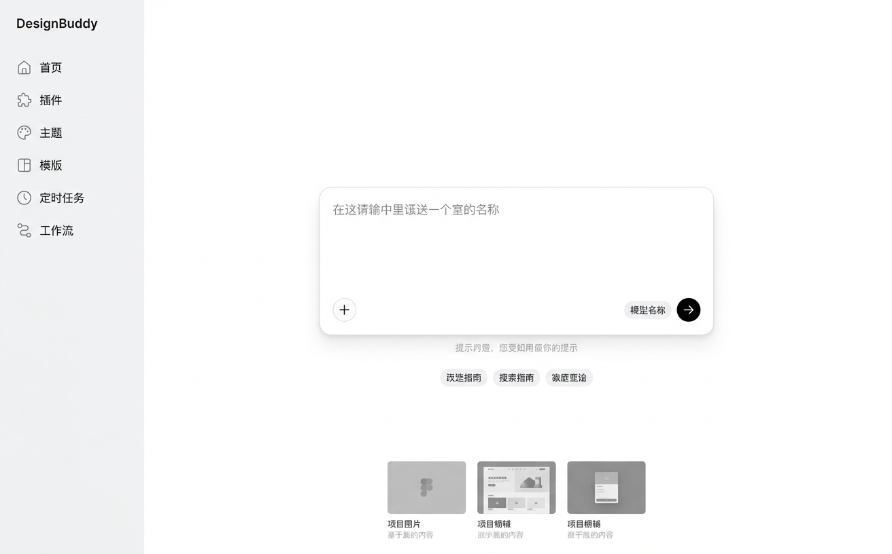
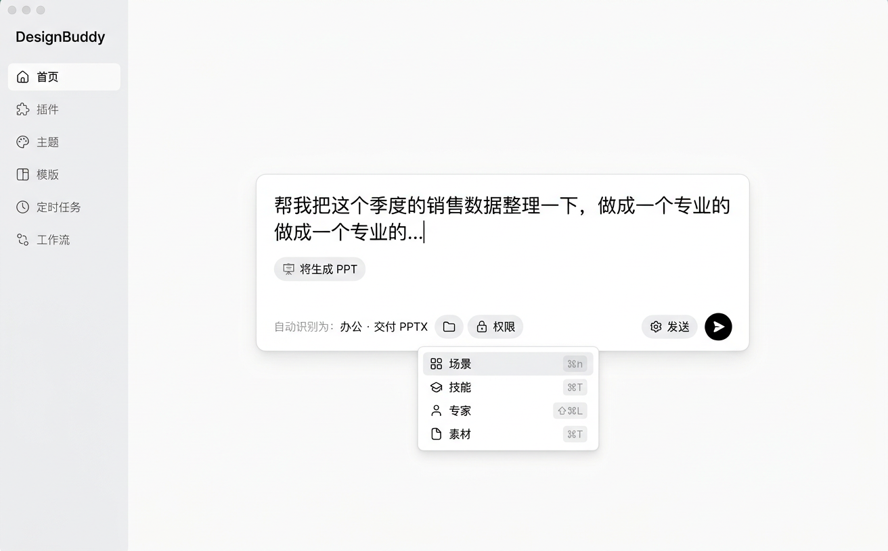

# 首页只留一个输入框：方案

> 结论先说：首页不是内容不够，是**并列的东西太多**。现在首页有 9 个纵向区块、约 50 个可点目标、248 条提示词任务、480 条插件规格挂在同一条链路上，而用户真正要做的动作只有一个 —— 描述一句话。
>
> 目标形态：**一个输入框 + 3 个示例 + 最近 3 个**。其余全部收进输入框的 `/` 菜单、`⌘K` 和侧边栏三处。
>
> 预计改动：P0 一天（删与并）、P1 两天（`/` `@` `#` 与意图 chip）、P2 一天（最近与埋点）。



---

## 1. 现状：首页到底有多少东西

按 DOM 顺序，首页（`App.tsx` 的默认分支）从上到下是这 9 块：

| # | 区块 | 组件 | 可点目标 | 它想解决什么 |
|---|---|---|---|---|
| 1 | 大标题 | `home27-hero` | 0 | 品牌 |
| 2 | 模式 tab（办公提效 / 设计制作 / 网页应用） | `mode-switch` | 3 | 让内容「相关」 |
| 3 | 快捷栏目（5 类 + 全部分类） | `HomeShortcuts` | 6 | 告诉你有多少场景 |
| 4 | 输入框 | `composer-shell` | 6（＋ / 模型 / 语音 / 发送 / 工作空间 / 权限） | 干活 |
| 5 | 插件轨道 | `HomePluginsRail` | 11（1 个入口 + 最多 10 行） | 展示已装/推荐插件 |
| 6 | 提示条 | `home-notice` | 1 | 反馈 |
| 7 | 热门场景（6 行 / 换一批） | `PromptRecommendations` | 7 | 推荐提示词 |
| 8 | 插件推荐（2 张卡） | `HomePluginPicks` | 3 | 推荐技能 |
| 9 | 交互样例（5 张，每张**真实渲染一个 SceneDemo**） | `SceneThumbnail` | 11 | 展示能力 |
| 10 | 更多场景（折叠，9 条） | `home27-more-scenes` | 10 | 收容剩余 |
| 11 | 两个「探索」外链（插件 / 工作流） | `home27-explore` | 2 | 导流 |

合计 **≈50 个可点目标**；背后有 248 条提示词任务（办公 88 / 设计 80 / 网页 80，11/10/10 个分类）、12 条快速动作、480 条插件规格。

两个额外事实：

- **第 9 块是「活」的**：5 张样例不是图片，每张都挂了一个完整的 `SceneDemo`（表格、看板、幻灯片各一个真实组件），再用 `transform: scale()` 缩到卡片里。首屏因此又重又花。
- **第 2 块会重排第 3/7/8/9/10 块**：换一个 tab，下面五块内容全换。所以首页其实是**三份首页**，用户每次进来先做一道分类选择题。

---

## 2. 为什么「多」不等于「强」

1. **入口并列，而不是入口收敛。** 模式、栏目、场景、插件、样例，五者都在争夺「我该点哪个」。用户没有心智模型去区分「快捷栏目」和「更多场景」和「插件推荐」的边界 —— 我们也很难用一句话解释。
2. **模式 = 导航。** 一个输入框的页面不该有三种形态。模式应该由输入的句子判断（现在 `isPptPrompt()` 已经在做这件事了，只是范围只有一个 PPT），而不是让用户先选。
3. **五个区块在「展示」，一个区块在「干活」。** 热门场景、插件推荐、交互样例、更多场景、两个外链，本质都是「看看能做什么」；真正的动作只有输入。展示区占比 5:1，页面自然显得乱。
4. **没有承接。** 首页不知道你上次做到哪，每次都是全新的一屏推荐。真正能降低决策成本的是「继续上次」，可它不在首页。

---

## 3. 目标形态

三条原则：

- **单一入口**：屏幕上只有一个可以「开始」的地方。
- **按需展开**：能力不消失，但要用户伸手时才出现（输入 `/`、`@`、`⌘K`、拖文件）。
- **一次一件事**：同一时刻只出现一个建议层，不同时给三类推荐。

三个状态（对应两张图）：

```
空状态                                    输入中
┌──────────────────────────────┐          ┌──────────────────────────────┐
│  DesignBuddy                 │          │  DesignBuddy                 │
│                              │          │                              │
│      ┌────────────────────┐  │          │   ┌────────────────────────┐ │
│      │ 描述你要完成的事…  │  │          │   │ 把这个季度销售整理成 PPT│ │
│      │ ＋        模型  ➤ │  │          │   │ [将生成 PPT]           │ │
│      └────────────────────┘  │          │   │ 自动识别：办公 · PPTX   │ │
│   / 场景  @ 专家  # 素材     │          │   └────────────────────────┘ │
│   做周报 · 做路演 · 做落地页 │          │   ┌ / 菜单 ────────────────┐ │
│                              │          │   │ 场景 / 技能 / 专家 / 素材│ │
│   最近：Q3 复盘 · 官网改版    │          │   └────────────────────────┘ │
└──────────────────────────────┘          └──────────────────────────────┘
```



（两张是示意图，用来对齐密度和层级；实际实现按第 8 节的颜色与圆角走现有 `.composer-shell` 的样式。）

---

## 4. 一个输入框怎么表达所有内容

| 原来在首页上的东西 | 现在怎么写 | 背后谁承接 |
|---|---|---|
| 办公 / 设计 / 网页 三个 tab | 不写，从句子判断；识别结果显示成 chip，点一下可改 | `inferMode()`（新，规则表见 §5） |
| 88 + 80 + 80 条提示词任务 | 自然语言描述，或 `/周报` `/路演` 搜场景 | `promptLibrary` 现有数据 + `⌘K` |
| 6 个快捷栏目 / 更多场景 | `/` 菜单 + `⌘K` 的「场景」组 | `HomeCommandPalette`（已存在） |
| 插件轨道（≤10 行） | `/` 菜单里只放 3 个**已启用**的；其余去插件页 | `useHomePlugins` + `/plugins` |
| 插件推荐 2 张卡 | `/` 菜单顶部「推荐的技能」 | `pluginPicks`（已有） |
| 交互样例 5 个 | 删除首页入口，去 `/inspiration`（那边本来就是干这个的） | 现有路由 |
| 两个「探索」外链 | 删除（侧边栏已有插件 / 工作流） | 侧边栏 |
| 专家选择 | `@张工` 或 `＋` 菜单 | `HomeAttachMenu` 现有专家数据 |
| 素材 / 项目引用 | `#官网改版` / `#品牌手册` | `/library`、`projectStore` |
| 附件 | 拖进输入框、粘贴截图、`＋` | 现有上传链路 |
| 输出格式（PPT / 表格 / 网页 / 图片） | 自然语言，识别成 chip（如「将生成 PPT」） | 现有 `isPptPrompt()` 扩成 `detectDeliverable()` |
| 工作空间 / 权限 | 输入框尾部「⋯」，默认值不占位 | 现有两个 select |
| 模型 | 保持现位置（在选择器里，已习惯） | 现有 `HomeModelMenu` |
| 「全部能力」 | `⌘K` | 现有 palette，扩到 5 组 |

一句话示例（都在一个框里完成）：

```
把这个季度的销售数据整理成 12 页路演稿，用 /路演 的结构，@张工 的口径，附上 #Q3数据
```
→ 识别结果：`办公` · `PPTX` · 技能「路演」· 专家「张工」· 引用「Q3数据」· 附件 1 个。

---

## 5. 语法与识别规则（要能测）

**显式永远优先，隐式只做兜底。**

1. 显式触发符（用户主动，不猜）：
   - `/` → 场景 / 技能 / 插件三者合一的候选列表（分组显示，`↑↓` 选，`Tab` 补全）
   - `@` → 专家（含「自动匹配」一项）
   - `#` → 素材、项目
   - 拖入文件 → 附件
2. 隐式判断（只在没有任何显式标记时生效）：

| 维度 | 规则（正则/关键词，按优先级） | 结果 chip |
|---|---|---|
| 交付物 | `ppt|幻灯片|路演|汇报|提案` → PPTX；`表格|xlsx|数据透视` → XLSX；`网页|落地页|h5` → HTML；`图片|海报|banner` → 图片 | `将生成 PPT` |
| 模式 | `接口|代码|仓库|bug|测试` → code；`配色|字体|版式|logo` → design；其余 → office | `办公` |
| 专家 | 复用现有 `useExpertMatch` 命中时展示 | `@张工`（可改） |
| 领域 | 不做（不猜行业） | — |

3. 冲突与纠错：
   - 同一时刻**只显示一个**交付物 chip（避免「将生成 PPT」「将生成图片」同时出现）。
   - 用户点开 chip 改过之后，**本轮不再自动覆盖**（"我刚选了你又改"是最招人烦的一种智能）。
   - 判不出来就不显示 chip，不要让规则硬猜。

4. 有意不做：不用大模型判断意图。首字延迟、成本、不可解释，而且规则表已经能覆盖首页 80% 的真实输入。

---

## 6. 三处承载（原区块的迁移去向）

| 原区块 | 去向 | 理由 |
|---|---|---|
| 模式 tab | 删除 | 判断 + 可改 chip，比选 tab 快一步 |
| 快捷栏目 / 更多场景 | `⌘K`「场景」组 + 输入框下 3 个示例 | 需要"被看见"的只有 3 个，其余靠搜 |
| 插件轨道 | 插件页；`/` 菜单里只留 3 个已启用 | 首页不该是一条 10 行的滚动列表 |
| 插件推荐 | `/` 菜单顶部 | 同一个动作内的推荐才有意义 |
| 交互样例 5 个 | `/inspiration` | 那是它们的家，且不再让首页渲染 5 个真实应用 |
| 两个探索外链 | 删除 | 侧边栏已有 |
| 工作空间 / 权限 | 输入框尾部「⋯」（默认收起） | 90% 的人不改默认值 |
| 热门场景 6 行 | 3 个示例 + `⌘K` | 6 行 = 又一份目录 |

一句话：**首页留「一个框 + 三个例子 + 最近」，其余进「三处兜底」：`/`、`⌘K`、侧边栏。**

---

## 7. 三个状态的规格

### 7.1 空状态
- 竖排居中：标题（保留 `home.title`）→ 输入框 → 一行语法提示（`/ 场景 · @ 专家 · # 素材`）→ 3 个示例 chip。
- 3 个示例来自 `recommendPrompts()` 现成排序，但**只取 3 个**，且随输入实时更换（不再是 6 行列表）。
- 「最近」仅在有项目时出现，最多 3 个，低对比度，不抢注意力。
- 首屏不再有：tab、栏目、轨道、推荐、样例、外链。

### 7.2 输入中
- 输入框自动增高（现有 `autoResize` 行为保留，受 `home-composer-autosize.spec.ts` 约束）。
- 文本下方一行：`〔图标〕将生成 PPT` + `自动识别为：办公 · PPTX`，两者都可点。
- `/`、`@`、`#` 触发一个浮层（复用 `HomeAttachMenu` 的定位与键盘逻辑），最多 6 行 + 滚动。
- 不做「边打字边弹三个推荐」。

### 7.3 有历史
- 最近 3 个项目（缩略图 + 标题 + 相对时间），点击直进编辑器。
- 其余仍在 `/projects`。

### 7.4 键盘与可访问性
| 操作 | 键 |
|---|---|
| 打开全部能力 | `⌘K` / `Ctrl+K`（现有） |
| 场景 / 专家 / 素材 | `/` `@` `#` |
| 菜单移动 / 确认 / 关闭 | `↑↓` / `Enter`、`Tab` / `Esc` |
| 发送 / 换行 | `Enter` / `Shift+Enter` |
| 从输入框发送 | `Tab` 到发送按钮 ≤ 5 次 |

- 识别结果通过 `aria-live="polite"` 播报一次（「已识别为演示文稿」）。
- 输入框 `aria-label` 保持「任务描述」不变，发送按钮保持「开始任务」，**让现有测试的语义选择器继续可用**。

---

## 8. 视觉细节（沿用现有风格，不新造）

- 输入框：沿用 `.composer-main`（3px `#ececec` 描边、27px 圆角、`0 5px 15px #00000003`），不做卡片堆叠。
- 示例 chip：`1px #e5e5e5` + 12px 圆角 + 12px 字号，hover 变 `#f2f2f2`。
- 识别 chip：底色 `#f2f2f2`、图标 12px、可点区域 ≥ 28px 高。
- 发送按钮：保持黑色圆形（`#242428`），不做渐变。
- 整页背景与侧栏不变（`#f2f2f2` / 白），不引入第三个强调色。
- 空状态上下留白 ≥ 96px，让"空"是真的空。

---

## 9. 分阶段实施

### P0（1 天）—— 删与并，先瘦身
1. `App.tsx` 首页分支重排：删除模式 tab、`HomePluginsRail`、`HomePluginPicks`（首页侧）、交互样例、更多场景、两个外链。
2. 新增 `apps/web/src/components/homeIntent.ts`：`inferMode()`、`detectDeliverable()`（把 `isPptPrompt()` 迁进来并扩展），纯函数、可单测。
3. 新增 `HomeSuggestionBar`：3 个示例 chip，数据来自 `recommendPrompts()`。
4. 输入框下方加识别 chip + 语法提示行；工作空间/权限收进「⋯」。
5. `⌘K` 保持不变（它已经能搜场景 / 插件 / 技能 / 页面）。

**要同步改的测试**（这几个文件现在逐条断言了首页结构，跑一遍就会红）：

| 文件 | 现在断言什么 | 需要改成 |
|---|---|---|
| `home.spec.ts` | mode tab、`.home27-shortcut` = 6、`.home27-scene` = 5、`.home27-more-scenes` | tab 与改名区块删除；断言 3 个示例 chip |
| `home-reference.spec.ts` | `.home27-shortcuts` 与 `.home27-scenes` 的几何位置、两者计数、`.home-prompt-list` | 改为 输入框 → 示例 的几何关系 |
| `home-composer-autosize.spec.ts` | `.home-prompt-recommendations` 在 composer 下方、`.home-prompt-list` 行高 | 选择器换成 `.home-suggestion-bar` |
| `prompt-browser.spec.ts` | `.home27-shortcut` 的栏目顺序与跨刷新持久化、`.home-prompt-list` 换批 | 决定 `HomeShortcuts` 是否保留为组件：保留（只从首页摘掉）则本文件不动 |

`scenes.spec.ts` 不依赖首页卡片（它走 `/inspiration`），无需改动。

**验收**：首屏可点目标 ≤ 12；1440×900 下不滚动即可完成「输入 → 发送」；`pnpm --filter designbuddy-web test:home` 全绿。

### P1（2 天）—— 一个框表达所有
1. `/` `@` `#` 浮层：数据复用 `HomeAttachMenu`（专家/技能）、`promptLibrary`（场景）、`projectStore`（项目）。
2. 拖拽 / 粘贴文件进输入框（现有 `uploadAsset` 链路）。
3. 识别 chip 可点改，改后本轮锁定。
4. `⌘K` 扩到 5 组（场景 / 技能 / 插件 / 项目 / 页面）。

**验收**：`/路演` `@张工` `#Q3数据` 三种写法都能落到对应对象；纯键盘可完成一次带附件的发送。

### P2（1 天）—— 承接与度量
1. 「最近」3 项接入 `projectStore` 与 PPT 项目。
2. 埋点：示例点击、chip 改写、`/` 菜单使用、首条输入长度。
3. 去掉一个版本的双入口提示（见 §11）。

---

## 10. 指标与验收

| 指标 | 现在 | 目标 |
|---|---|---|
| 首屏可点目标 | ≈50 | ≤12 |
| 首页纵向区块 | 9 | 3（标题 / 输入 / 示例+最近） |
| 到达「发送」的 Tab 次数 | 6+ | ≤5 |
| 首屏需要滚动才能看完 | 是 | 否（1440×900） |
| 首页渲染的真实应用组件 | 5 | 0 |
| 空状态决策时间（可用性测试） | 待测 | 3 秒内开始打字 |

不看「首页停留时长」这类指标 —— 缩短到动作的时间才是这次的目的。

---

## 11. 风险与对策

| 风险 | 表现 | 对策 |
|---|---|---|
| 发现性下降 | "现在能做什么？"变模糊 | 3 个示例 + `/` 菜单 + `⌘K` 三处兜底；空状态一行语法提示 |
| 模式判断错 | 设计任务被当成办公 | chip 一键改；手改后本轮不覆盖；模式只影响建议、不影响能力 |
| 老用户肌肉记忆 | 找不到插件轨道 | 一个版本内保留侧边栏入口；插件页做「已启用」置顶 |
| 测试大面积变红 | CI 拦住合并 | 保留 `任务描述` / `开始任务` 等语义名；测试改动集中在 4 个 spec |
| i18n 成本 | 17 个语言文件 | 删除的键先留（不删 catalogs），只新增 3–4 个键 |
| 场景数据变"看不见" | 248 条提示词失去曝光 | `⌘K` 与 `/` 都能搜；示例每日轮换 |

---

## 12. 不做的事

- 不做 AI 生成式"首页推荐流"（要服务端、要有解释、且我们现在的问题恰恰是推荐太多）。
- 不做多列卡片瀑布流。
- 不做新手引导 tour / 遮罩教学（把页面做简单，就不需要教）。
- 不合并侧边栏（侧栏是导航，不是内容）。

---

## 13. 如果只想先做半天

最小可行 = **删 5 个区块 + 加 3 个示例 chip**：

1. 摘掉：模式 tab、插件轨道、插件推荐、交互样例、更多场景、两个外链（纯删除，不动逻辑）。
2. 把 `home27-shortcuts` 的 6 个栏目换成 3 个示例 chip（数据用 `recommendPrompts()` 现成结果）。
3. 输入框下面加一行 `/ 场景 · @ 专家 · # 素材` 的提示（先只做文案，不做浮层）。

这一步就能把首页从"仓库"变成"入口"，且不改任何任务执行逻辑，`⌘K` 与侧边栏承担全部兜底。
